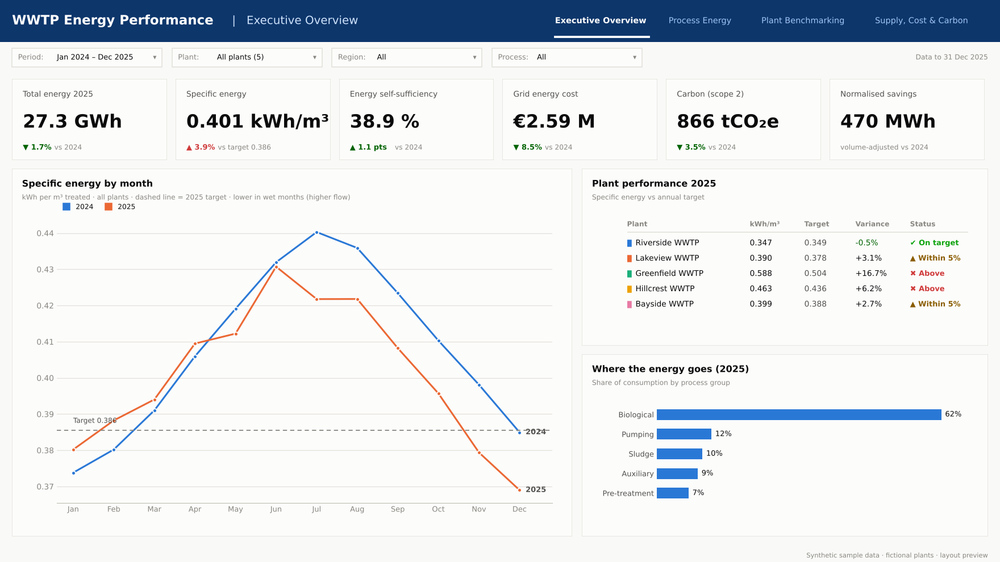
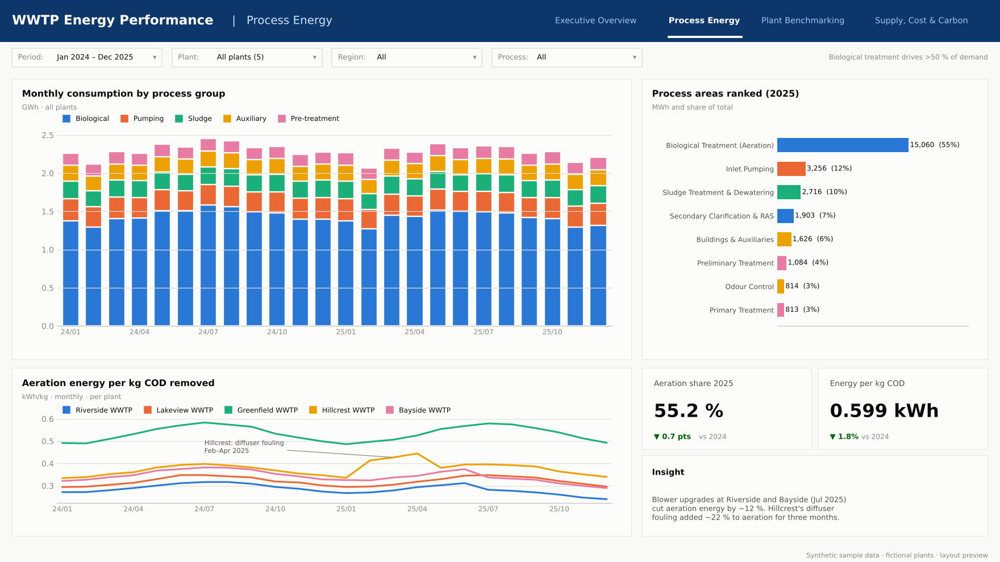
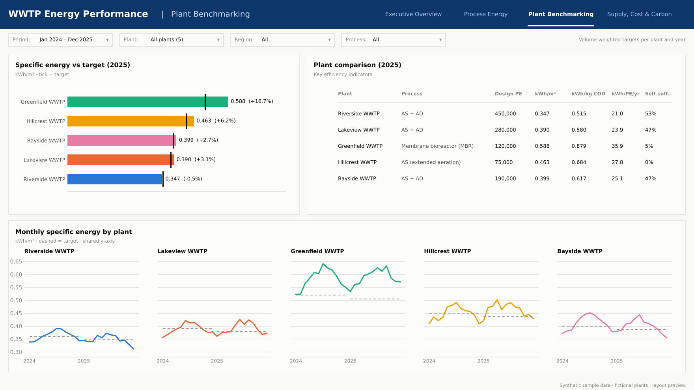
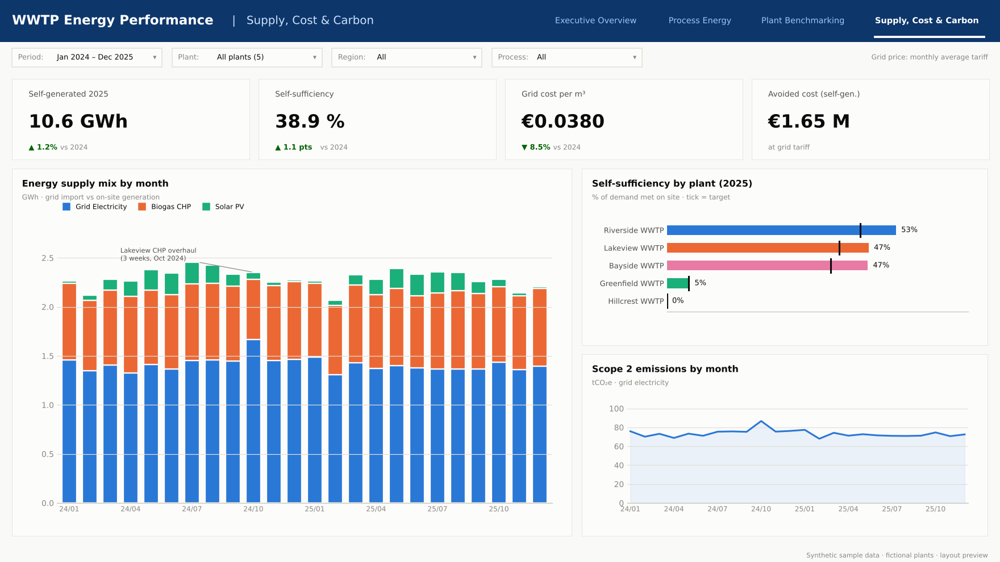
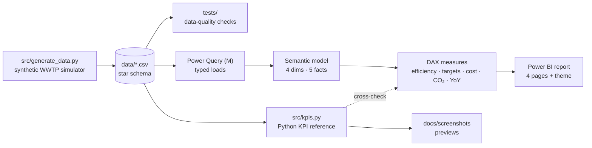

# ⚡ Wastewater Treatment Plant Energy Performance Dashboard

**An end-to-end Power BI project that monitors electricity use, energy efficiency, on-site generation, cost and carbon across five wastewater treatment plants (WWTPs).**




> **All data in this repository is synthetic.** The plants, figures and events are fictional. They're generated by `src/generate_data.py` using typical industry ranges for municipal activated-sludge plants. No real operational data is used.

---

## 📌 Business problem

Electricity is usually one of the largest operating costs of a wastewater treatment plant, and **aeration alone uses 50–60 % of it**. Operations and energy managers need to answer:

- How efficiently is each plant treating water, in **kWh per m³** and **kWh per kg of COD removed**?
- Which **process areas** drive consumption, and where are the savings?
- Are plants **meeting their energy targets**, and how do they compare?
- How much energy is **generated on site** (biogas CHP, solar PV), and what is it worth?
- What are the **grid cost** and **scope 2 carbon** footprint, and are they improving?

This dashboard answers those questions in four pages, using a star-schema model and a reusable set of DAX measures.

## 🔎 Key insights (sample data, 2025 vs 2024)

| | |
|---|---|
| **27.3 GWh** consumed in 2025 (−1.7 % YoY) | **0.401 kWh/m³** portfolio specific energy, **3.9 % above** the 0.386 target |
| **55 %** of electricity goes to biological treatment (aeration) | **38.9 %** energy self-sufficiency from biogas CHP and solar PV (+1.1 pts) |
| **€2.59 M** grid cost (−8.5 %), plus **€1.65 M** avoided through self-generation | **470 MWh** volume-normalised savings vs 2024 |

- **Greenfield WWTP (MBR)** is the least efficient plant at **0.588 kWh/m³, +16.7 % vs target**. Membrane air scour is the main lever.
- **Blower upgrades** at Riverside and Bayside (July 2025) cut aeration energy by about **12 %**, so Riverside is now **on target**.
- **Hillcrest WWTP** had **diffuser fouling** from February to April 2025, which raised aeration energy by about **22 %** and pushed the plant **6 % over target**.
- The **Lakeview CHP overhaul** in October 2024 stopped on-site generation for three weeks, and the extra grid import shows up clearly.
- Specific energy is **lowest in wet months**: rainfall raises flow while the pollutant load stays the same, so **kWh/m³ should always be read alongside kWh/kg COD**.

## 🖼️ Dashboard pages

| Executive Overview | Process Energy |
|---|---|
|  |  |
| **Plant Benchmarking** | **Supply, Cost & Carbon** |
|  |  |

1. **Executive Overview**: headline KPIs, the monthly specific-energy trend against target, plant status, and where the energy goes.
2. **Process Energy**: consumption by process group and area, and aeration intensity per plant.
3. **Plant Benchmarking**: specific energy against target, a KPI comparison matrix, and small-multiple trends.
4. **Supply, Cost & Carbon**: grid, CHP and PV supply mix, self-sufficiency against target, and scope 2 emissions.

*Previews are rendered from the sample data with `src/render_previews.py`, so the README always matches the data.*

## 🏗️ Architecture



### Data model

A star schema at **daily grain**: `Date`, `Plant`, `Process Area` and `Energy Source` dimensions, plus `Energy Consumption`, `Energy Supply`, `Operations`, `Targets` and `Energy Tariff`. Full ER diagram and data dictionary: **[docs/data-model.md](docs/data-model.md)**.

## 📐 KPIs and DAX

All measures are in **[powerbi/dax/measures.dax](powerbi/dax/measures.dax)**, grouped in display folders.

| KPI | Definition |
|---|---|
| Specific Energy | kWh ÷ m³ treated |
| Energy per kg COD | kWh ÷ kg COD removed (load-normalised) |
| Energy per PE | kWh ÷ design PE, annualised |
| Aeration Share % | Aeration kWh ÷ total kWh |
| Energy Self-Sufficiency % | (CHP + PV) ÷ total consumption |
| Grid Energy Cost | Σ monthly grid import × monthly tariff |
| Avoided Cost | Σ self-generated kWh × tariff |
| CO₂ Emissions | Σ supply × source emission factor |
| Variance vs Target | Specific energy vs **volume-weighted** plant target |
| Normalised Savings | (PY kWh/m³ − CY kWh/m³) × CY volume |

Example: a volume-weighted target that stays correct at any level (plant, region or portfolio):

```dax
Target Specific Energy (kWh/m3) =
VAR _t =
    ADDCOLUMNS (
        SUMMARIZE ( Operations, 'Date'[year], Plant[plant_code] ),
        "@vol", [Treated Volume (m3)],
        "@tgt", LOOKUPVALUE ( Targets[target_kwh_per_m3],
                              Targets[year], 'Date'[year],
                              Targets[plant_code], Plant[plant_code] )
    )
RETURN DIVIDE ( SUMX ( _t, [@vol] * [@tgt] ), SUMX ( _t, [@vol] ) )
```

## 🚀 Getting started

```bash
git clone https://github.com/Mayur96k/energy-performance-powerbi-dashboard.git
cd energy-performance-powerbi-dashboard
pip install -r requirements.txt

python src/generate_data.py      # (re)generate the synthetic CSVs in data/
python src/kpis.py               # print KPI summary (reference numbers)
python src/render_previews.py    # refresh dashboard previews
pytest -q                        # data-quality tests
```

Then build the report in Power BI Desktop by following **[powerbi/BUILD_GUIDE.md](powerbi/BUILD_GUIDE.md)**. It covers the Power Query loads, relationships, measures, theme and the layout of each page.

Generator options: `--start 2023-01-01 --end 2025-12-31 --seed 7`.

## 📁 Project structure

```
energy-performance-powerbi-dashboard/
├── data/                       # Synthetic star-schema CSVs (generated)
├── docs/
│   ├── data-model.md           # ER diagram, relationships, data dictionary, scenarios
│   └── screenshots/            # Dashboard page previews
├── powerbi/
│   ├── BUILD_GUIDE.md          # Step-by-step report build
│   ├── dax/measures.dax        # 40 DAX measures
│   ├── power-query/queries.pq  # Power Query (M) for every table
│   └── theme/wwtp-energy-theme.json  # Colour-blind-safe report theme
├── src/
│   ├── generate_data.py        # Synthetic WWTP data simulator
│   ├── kpis.py                 # Python KPI reference implementation
│   └── render_previews.py      # Renders the preview images
├── tests/test_data.py          # Keys, integrity, ranges, energy balance
├── .github/workflows/ci.yml    # Runs generator + tests on every push
└── requirements.txt
```

## 🧰 Tech stack

**Power BI** (Power Query M, DAX, star schema, custom theme) · **Python** (pandas, NumPy, matplotlib) · **pytest** · **GitHub Actions**

## 🗺️ Roadmap

- [ ] Commit the `.pbix` / `.pbip` report
- [ ] Plant drill-through page with daily process KPIs
- [ ] Weather-normalised baseline (regression of kWh vs flow and temperature)
- [ ] Anomaly flags for aeration energy (e.g. fouling detection)
- [ ] Incremental refresh and a deployment pipeline

## 👤 Author

**Mayur Jagtap**, Data & BI Engineer · [GitHub](https://github.com/Mayur96k)

## 📄 License

[MIT](LICENSE). The sample data is synthetic and free to reuse.
