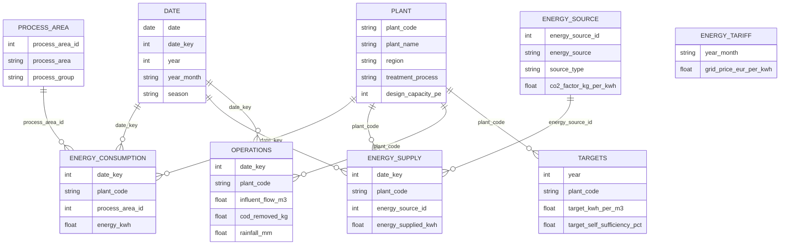

# Data model

Star schema with four dimensions and five fact/reference tables. All data is **synthetic** (see `src/generate_data.py`).

## Relationships (Power BI)

| From (many) | To (one) | Cardinality | Filter direction |
|---|---|---|---|
| Energy Consumption[date_key] | Date[date_key] | * : 1 | Single |
| Energy Consumption[plant_code] | Plant[plant_code] | * : 1 | Single |
| Energy Consumption[process_area_id] | Process Area[process_area_id] | * : 1 | Single |
| Energy Supply[date_key] | Date[date_key] | * : 1 | Single |
| Energy Supply[plant_code] | Plant[plant_code] | * : 1 | Single |
| Energy Supply[energy_source_id] | Energy Source[energy_source_id] | * : 1 | Single |
| Operations[date_key] | Date[date_key] | * : 1 | Single |
| Operations[plant_code] | Plant[plant_code] | * : 1 | Single |
| Targets[plant_code] | Plant[plant_code] | * : 1 | Single |

`Energy Tariff` (month grain) and `Targets` (year grain) aren't linked to `Date`. The measures read them with `LOOKUPVALUE`, which avoids many-to-many relationships.

## Data dictionary

### dim_date
| Column | Type | Description |
|---|---|---|
| date | date | Calendar day (mark as date table) |
| date_key | int | `YYYYMMDD` surrogate key |
| year, quarter, month_num, month_name | — | Calendar attributes (sort `month_name` by `month_num`) |
| year_month | text | `YYYY-MM`, join key to tariff |
| week_iso, day_of_week, is_weekend, season | — | Helper attributes |

### dim_plant
| Column | Description |
|---|---|
| plant_code | `WWTP01`–`WWTP05` |
| plant_name, region | Fictional plant name and region |
| treatment_process | e.g. activated sludge + anaerobic digestion, MBR |
| design_capacity_pe | Design capacity in population equivalents |
| design_flow_m3_per_day | Design daily flow |
| has_anaerobic_digestion | Plant produces biogas for CHP |
| solar_pv_kwp | Installed PV capacity (0 = none) |

### dim_process_area
Eight process areas in five groups: **Pumping** (inlet pumping), **Pre-treatment** (preliminary, primary), **Biological** (aeration, secondary clarification & RAS), **Sludge** (treatment & dewatering) and **Auxiliary** (odour control, buildings).

### dim_energy_source
| energy_source | source_type | CO₂ factor (kg/kWh) |
|---|---|---|
| Grid Electricity | Imported | 0.052 (illustrative) |
| Biogas CHP | Self-generated | 0 |
| Solar PV | Self-generated | 0 |

### fact_energy_consumption — day × plant × process area
`energy_kwh`: electricity used by that process area.

### fact_energy_supply — day × plant × source
`energy_supplied_kwh`: energy from CHP, PV or the grid. Grid import = consumption − self-generation (never below 0).

### fact_operations — day × plant
| Column | Unit |
|---|---|
| influent_flow_m3 | m³/day treated |
| rainfall_mm | mm |
| avg_temperature_c | °C |
| cod_load_in_kg, cod_removed_kg | kg COD/day |
| effluent_cod_mg_l, effluent_nh4_mg_l | mg/L |
| biogas_produced_nm3 | Nm³/day |
| sludge_produced_t_ds | tonnes dry solids/day |

### fact_energy_tariff — month
`grid_price_eur_per_kwh`: illustrative average industrial grid price.

### fact_targets — year × plant
`target_kwh_per_m3` and `target_self_sufficiency_pct`. 2025 targets are 3 % tighter than 2024.

## Built-in scenarios

The generator includes realistic events so the dashboard has something to find:

| Event | Plant | Period | Effect |
|---|---|---|---|
| Blower upgrade | Riverside, Bayside | from Jul 2025 | Aeration energy −12 % |
| Diffuser fouling | Hillcrest | Feb–Apr 2025 | Aeration energy +22 % |
| CHP overhaul | Lakeview | 7–27 Oct 2024 | No CHP output, so grid import rises |
| Storm events | All | Random | Flow peaks, so kWh/m³ falls |
| MBR process | Greenfield | Always | Highest specific energy (membrane air scour) |
